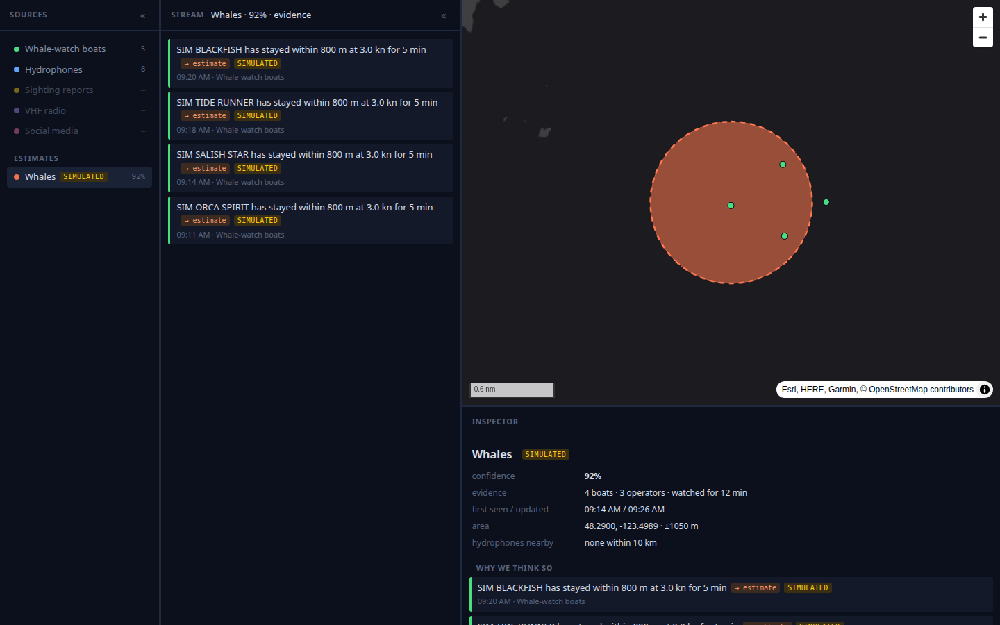

# planetar-ui-orca

Where are the whales around Victoria, BC right now, and **why do we think so?**

A sibling of [planetar-ui](https://github.com/planetarx/planetar-ui) for one mission: tracking whales (orcas above all) from the behaviour of whale-watching boats in live AIS, with every estimate traceable to the sensor data behind it. Sources are listed on the left; click one to see its live stream; the map and inspector on the right show each estimate and the evidence it rests on.

Design: [`docs/superpowers/specs/2026-10-31-planetar-ui-orca-design.md`](docs/superpowers/specs/2026-10-31-planetar-ui-orca-design.md). Wire contract: [`docs/CONTRACT.md`](docs/CONTRACT.md).

## Run (on bb, beside the planetar pm2 tier)

```
npm install
npm run dev          # Vite :5290 + bridge ws://127.0.0.1:9400 + inference service :9410
npm run test:service # node:test, the inference
npm test             # Playwright (bundled Chromium)
```

The bridge and the service connect to the running planetar broker (12001 publish, 12002 subscribe). Don't start a second broker.

## Status (2026-10-31)

v1 built and running on bb (plan: `docs/superpowers/plans/`).



*A simulated encounter (`node service/simulate.mjs service/scenarios/race-rocks.json --speed 10`): four boats from three operators hold off a whale group; the estimate is labelled "Whales", not "orca", and every piece of evidence behind it is listed.*

- **Boats (live):** planetar-ais's `planetar:ais-orca` pm2 process streams and records AIS for Victoria, Race Rocks, Haro Strait and the San Juans (`../planetar-ais/data/ais-orca/`).
- **No real boats are listed yet.** Only vessels in `service/data/whale-watch-vessels.json` are tracked, and it holds only the simulated `99900000x` boats. Add real whale-watch operators' vessels by hand (`mmsi`, `name`, `operator`, `"verified": true`); the recorded AIS is the place to find candidates.
- **Thresholds** are in `service/config/inference.json`, set by judgement and checked only against the simulated scenario. Real tuning waits for the 2027 whale-watch season and the recorded AIS.
- **Hydrophones (since 2026-11-02):** the service polls OrcaHello's public detections API (Orcasound's AI call detector, last 24 h, every 5 min; `ORCAHELLO=off` disables it, and Playwright runs with it off). Every detection shows in the Hydrophones stream with its audio. Only a moderator-confirmed one counts, on a real boat estimate within 10 km and 30 min, and the species the moderator tagged (Southern Resident, Bigg's, humpback) becomes the estimate's label. A confirmed call with no boat estimate near it makes a hydrophone-only estimate (5 km around the hydrophone, alive 2 h after its latest call; boats gathering nearby absorb it), so the map still shows whales when no boats are out. The moderator's e-mail, which the API returns, is never kept.
- **Next sources:** a sighting-report feed (Acartia, needs an API key). VHF radio and social media are listed and greyed out.
- **Simulation** publishes on `sim.vessel.ais.position`, so planetar-ontology and planetar-ui never store the fake vessels; each replay is inferred in its own world.

License: GPL-3.0-or-later.
